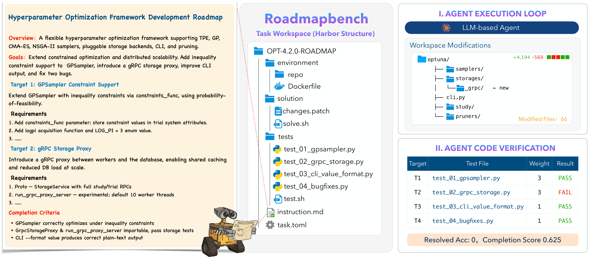
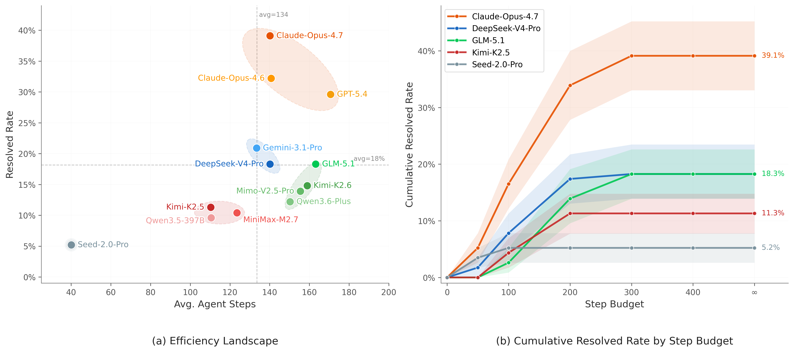

<p align="center">
  <picture>
    <source media="(prefers-color-scheme: dark)" srcset="docs/figures/pipelinelab-logo-dark.png">
    
  </picture>
</p>

# EdgeBench SWE

EdgeBench SWE is a long-horizon coding agent benchmark built from real open-source version upgrades. Each task places an agent on a frozen source-version snapshot of a production repository and hands it a roadmap: implement the functionality the next release introduced. The median task touches 51 files and about 3,700 lines of code, two orders of magnitude beyond an issue fix, and is scored target by target rather than pass or fail.

**Website:** [pipelinelab.ai](https://pipelinelab.ai) · **Blog post:** [EdgeBench SWE: Transitioning Large Models from Issue Fixes to Long-Horizon Feature Development](https://pipelinelab.ai/blog/edgebenchswe) · **Catalog page:** [pipelinelab.ai/demo/edgebench](https://pipelinelab.ai/demo/edgebench)

| | |
|---|---|
| Tasks | 115, drawn from 17 repositories |
| Languages | Python, TypeScript, C++, Go, Rust |
| Domains | ML and data, web and RPC, ORM and validation, infrastructure and tooling, UI and rendering |
| Targets per task | 3 to 12, median 5 |
| Oracle patch size | under 300 to over 30,000 lines changed, median 3,700 lines across 51 files |
| Format | [Harbor](https://github.com/harbor-framework/harbor) tasks with a pinned Docker environment and a per-target verifier |
| Published here | 3 complete tasks (Java, C++, TypeScript) |

<p align="center">
  
</p>

## Why version upgrades

Coding agents clear most of SWE-bench Verified, but that benchmark measures isolated bug fixes with oracle patches of about 33 lines. Real development work is coordinated feature sets across a codebase over weeks: a version upgrade touches thousands of lines, dozens of files and several subsystems. EdgeBench SWE sits at the intersection of multi-language coverage, version-level scope and fine-grained subtask scoring, a combination no existing benchmark provides.

| Benchmark | Tasks | Languages | Scope | Subtask scoring | Solution scale |
|---|---:|---|---|---|---|
| SWE-bench Verified | 500 | Python | Commit | no | ~33 LOC |
| SWE-bench Pro | 1,865 | Multi | Commit | no | ~107 LOC |
| FeatureBench | 200 | Python | Commit | no | ~790 LOC |
| TerminalBench | 89 | Multi | Task | no | ~280 LOC |
| SWE-EVO | 48 | Python | Version | no | ~611 LOC |
| NL2Repo | 104 | Python | Repo | no | ~3,000 LOC |
| **EdgeBench SWE** | **115** | **Multi (5)** | **Version** | **yes (avg 5 targets)** | **~3,700 LOC** |

## How a task works

The agent receives:

- **A source-version repository snapshot**, the full codebase pinned at the earlier release, inside an isolated Docker environment.
- **A multi-target roadmap instruction**, which states what to implement (API signatures, parameter semantics, default values, exception behaviour) without saying how. No data structures, no algorithm hints, no repository or version identifiers.
- **Per-target test suites**, adapted from the project's own upstream tests, each verifying one target independently. These are withheld from the agent, as are the target-version code and the oracle patch.

Two metrics are reported. **Resolved Rate** is the fraction of tasks where every target passes. **Completion Score** is the mean weighted fraction of targets passed, with weights proportional to implementation complexity, so partial progress counts. See [SCORING.md](SCORING.md) for the verifier, the weights and the validation checks every task passes before release.

## Results

Thirteen models evaluated on the full 115-task set. Resolved rate and completion score overall, then resolved rate by domain.

| Model | Resolved (%) | Completion | Avg turns | ML & Data | Web & RPC | ORM & Val | Infra & Tool | UI & Render |
|---|---:|---:|---:|---:|---:|---:|---:|---:|
| Claude Opus 4.7 | 39.1 | 0.692 | 140 | 30.6 | 41.2 | 32.0 | 43.5 | 64.3 |
| Claude Opus 4.6 | 32.2 | 0.627 | 141 | 25.0 | 29.4 | 32.0 | 30.4 | 57.1 |
| GPT-5.4 | 29.6 | 0.497 | 171 | 27.8 | 17.6 | 20.0 | 39.1 | 50.0 |
| Gemini 3.1 Pro | 20.9 | 0.439 | 133 | 8.3 | 23.5 | 24.0 | 26.1 | 35.7 |
| DeepSeek V4 Pro | 18.3 | 0.486 | 140 | 8.3 | 17.6 | 24.0 | 17.4 | 35.7 |
| GLM 5.1 | 18.3 | 0.453 | 163 | 8.3 | 11.8 | 28.0 | 26.1 | 21.4 |
| Kimi K2.6 | 14.8 | 0.432 | 159 | 5.6 | 5.9 | 20.0 | 21.7 | 28.6 |
| Mimo V2.5 Pro | 13.9 | 0.440 | 156 | 8.3 | 11.8 | 12.0 | 21.7 | 21.4 |
| Qwen 3.6 Plus | 12.2 | 0.424 | 150 | 5.6 | 5.9 | 12.0 | 21.7 | 21.4 |
| Kimi K2.5 | 11.3 | 0.378 | 110 | 0.0 | 5.9 | 12.0 | 17.4 | 35.7 |
| MiniMax M2.7 | 10.4 | 0.332 | 124 | 5.6 | 0.0 | 8.0 | 26.1 | 14.3 |
| Qwen 3.5 397B | 9.6 | 0.383 | 111 | 0.0 | 11.8 | 12.0 | 13.0 | 21.4 |
| Seed 2.0 Pro | 5.2 | 0.177 | 40 | 0.0 | 5.9 | 8.0 | 4.3 | 14.3 |

Three patterns hold across the table. Partial progress is common and full completion is rare: completion scores exceed resolved rates by a wide margin, because agents make headway on early targets and stall on later ones. ML and Data is the hardest domain; six of thirteen models resolve nothing in it. And longer trajectories do not buy better results: most models plateau within 200 steps, and what separates the top tier is step efficiency, not step count. The [blog post](https://pipelinelab.ai/blog/edgebenchswe) covers the efficiency, tool-usage, failure-mode and scaffold-sensitivity analyses.

<p align="center">
  
</p>

## Published tasks

Three complete tasks from the set, one each in Java, C++ and TypeScript.

| Task | Language | Roadmap |
|---|---|---|
| [gson-gson-parent-2.8.0-roadmap](tasks/gson-gson-parent-2.8.0-roadmap/) | Java | Modernise a JSON serialization library: align streaming with RFC 7159, add lenient configuration, atomic, currency and concurrent-map adapters, overhaul the `@JsonAdapter` annotation, add TypeToken and instance-introspection APIs, tighten the type-hierarchy runtime check. 7 targets. |
| [libzmq-4.0.0-roadmap](tasks/libzmq-4.0.0-roadmap/) | C++ | Upgrade a messaging library across a major version: a public base-85 codec, a shutdown and finalize split for the context lifecycle, a zero-copy send entry point, a raw-TCP socket type, a conflate socket option, connect-before-bind for the in-process transport, and renamed socket options with an inheritable IPv6 default. 8 targets. |
| [turf-3.13.0-roadmap](tasks/turf-3.13.0-roadmap/) | TypeScript | A modular geospatial toolkit roadmap: overlapping-polygon masking, a great-circle module, a line-chunk module, native flatten with property propagation, hardened factory validation, a generalised coordinate unwrapper, and a final-bearing option. 7 targets. |

Each task directory is a Harbor task:

```
tasks/<task>/
├── instruction.md          the roadmap given to the agent
├── task.toml               metadata, agent and verifier timeouts, environment resources
├── environment/
│   ├── Dockerfile          pinned build of the source-version snapshot
│   └── repo/               the repository at the source version
├── tests/
│   ├── test.sh             the verifier: builds, runs each target's tests, writes rewards
│   └── <per-target tests>
└── solution/
    ├── changes.patch       the oracle patch from source to target version
    └── solve.sh            applies it
```

The repository snapshots are vendored without their git history. The agent works in `/app`; the verifier and solution are mounted at `/tests` and `/solution` and are not visible during the agent's session.

## Running a task

With [Harbor](https://github.com/harbor-framework/harbor) installed, point it at a task directory and an agent:

```bash
harbor run --task tasks/gson-gson-parent-2.8.0-roadmap --agent <your agent>
```

To build the environment on its own:

```bash
cd tasks/gson-gson-parent-2.8.0-roadmap/environment
docker build -t edgebench-gson .
docker run --rm -it edgebench-gson
```

To check that the oracle passes, run `solution/solve.sh` inside the environment and then `tests/test.sh`.

## The full set

The 115-task set, with per-task weights, trajectories from the evaluated models and the quality-control record, is available from Pipeline Lab. The catalog page at [pipelinelab.ai/demo/edgebench](https://pipelinelab.ai/demo/edgebench) shows the Data Card and sample tasks. Write to [contact@pipelinelab.ai](mailto:contact@pipelinelab.ai).

## Citation

```bibtex
@misc{edgebenchswe2026,
  title  = {EdgeBench SWE: Transitioning Large Models from Issue Fixes to Long-Horizon Feature Development},
  author = {Pipeline Lab},
  year   = {2026},
  url    = {https://pipelinelab.ai/blog/edgebenchswe}
}
```

The repository snapshots in `tasks/*/environment/repo` are the upstream projects' own code and remain under their own licenses. The task instructions, tests and patches are released for research and evaluation use.
